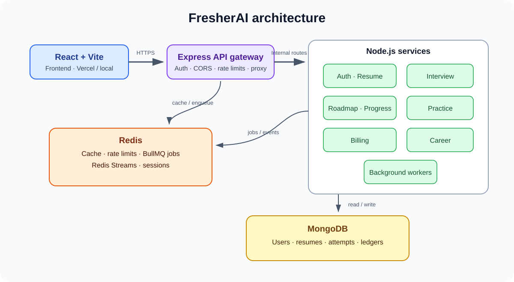

# FresherAI

FresherAI is an AI-assisted practice platform for graduates preparing for technical interviews. It includes resume feedback, mock interviews, learning roadmaps, quizzes, SQL/coding practice, job matching, and application tracking.

> **Live demo:** not deployed yet. **Demo account:** not available yet. A Cloud Run workflow is prepared but intentionally waits for Google Cloud billing, identity, and secret setup. See [deployment setup](ops/cloudrun/README.md).
>
> **Demo video/GIF:** not recorded yet. The script and capture checklist are in [docs/demo-video-script.md](docs/demo-video-script.md). The README is ready for the final GIF, unlisted video, and deployed link once you provide/record them.

## Architecture



The React/Vite frontend calls an Express gateway. The gateway checks authentication, CORS, rate limits, and proxies to independent Node services. Redis supports cache, sessions, rate limiting, BullMQ jobs, and Redis Streams; MongoDB stores application data. Resume scoring runs through a worker. Progress and roadmap consume events from Redis Streams. External AI calls use configured providers.

| Component | Responsibility |
|---|---|
| Gateway | Authentication boundary, CORS, request limits, routing, SSE proxy |
| Auth | Firebase identity and user data |
| Resume | PDF text/OCR extraction and queued scoring |
| Interview | Mock interviews, behavioral/design modes, feedback streaming |
| Roadmap / Progress | Personalized roadmaps, readiness, streaks, event aggregates |
| Practice | Question packs, quizzes, SQL and coding practice |
| Career | Job-description matching, cover letters, application tracking |
| Billing | Coin balances, ledger, and Razorpay webhook handling |
| Redis / MongoDB | Ephemeral/shared queue and event state / persistent application records |

## Start from a fresh clone

Prerequisites: Git, Docker Desktop with Compose, and a browser. For running scripts outside containers, use Node.js 22 or later. Third-party credentials are optional for starting the stack; authenticated AI and payment flows need their corresponding providers.

```bash
git clone https://github.com/DivayJainDJ/Fresher-Ai.git
cd Fresher-Ai
cp .env.example .env
# Edit .env and add credentials only for features you intend to try.
docker compose up --build
```

Open the frontend at `http://localhost:5173`; the gateway health endpoint is `http://localhost:8000/health`. Compose starts local MongoDB as a single-node replica set and Redis. Stop with `Ctrl+C`; remove persisted Mongo data only when you intentionally want a clean database (`docker compose down -v`).

### Environment configuration

The root [`.env.example`](.env.example) is the Compose starting point. Copy it to `.env` at the repository root (never commit `.env`). Firebase keys enable sign-in, a Groq/Gemini/Cerebras key enables supported AI flows, and Razorpay keys enable payment flows. Compose supplies local service URLs and local Mongo/Redis to containers. Per-service examples live under `backend/**/.env.example`; use those when running a service outside Compose. For Cloud Run, use Secret Manager and the deployment guide rather than committing secrets.

## Verification and measurements

Run the project checks locally:

```bash
npm ci
npm test
npm run build:frontend
```

GitHub Actions builds the service images and frontend; the deploy job only runs after the documented Cloud Run setup and billing gate are enabled. For a fresh CI result, see [GitHub Actions](https://github.com/DivayJainDJ/Fresher-Ai/actions).

| Measurement | Result |
|---|---|
| Gateway throughput, p95, error rate | Pending same-machine k6 run; reports go to [`loadtest/results/`](loadtest/results/) |
| Cache impact and hit rate | Pending repeated/new-item comparison; see [`loadtest/RESULTS.md`](loadtest/RESULTS.md) |
| Streaming time to first token | Pending 20 same-prompt interviews; do not claim a timing until recorded |
| Resume scoring consistency and prompt-injection defense | Harness/setup in [`eval/README.md`](eval/README.md); add generated reports under `eval/results/` |
| Queue recovery, double-spend, event lag | Pending controlled local runs; protocol is in [`loadtest/RESULTS.md`](loadtest/RESULTS.md) |
| Test count / CI duration | Use the linked Actions run; retain its run link and branch with any reported value |

Every performance/cost number belongs in a generated report and must link to that report. Do not benchmark against free hosted tiers. Read [`loadtest/README.md`](loadtest/README.md) for commands and recording requirements.

## Technology choices

| Choice | Why it is used | Trade-off | Interview explanation |
|---|---|---|---|
| Node.js + Express services | One JavaScript runtime across gateway and APIs | More deployment/configuration pieces than a monolith | “I split boundaries around product domains and route them through one gateway.” |
| MongoDB + Mongoose | Flexible product records and transaction support for ledger operations | Schema discipline and transaction-capable deployment are still required | “I use documents for evolving records and transactions where balance invariants matter.” |
| Redis + BullMQ + Streams | Shared cache, rate limits, jobs, and event consumption | Redis memory/availability must be operated and consumers must be idempotent | “Slow work is queued, and stream consumers record event IDs so retries are safe.” |
| LangChain / LangGraph | Model integrations and structured interview flows | Provider behavior and output quality vary | “The graph organizes the interaction; schema validation constrains model output.” |
| Docker Compose | Reproducible local multi-service setup | Local container resources are heavier than running only the frontend | “A fresh clone starts the same service topology without hand-wiring dependencies.” |
| Vite + React | Fast frontend iteration and static deployment | Browser-only execution needs clear trust boundaries | “The UI stays responsive while server-owned actions remain authoritative.” |
| Cloud Run (planned) | Scale-to-zero for low-traffic demos | Cold starts and external GCP setup | “I can deploy private services behind an authenticated gateway and avoid always-on instances.” |

## Local event-lag benchmark

The progress package includes a Redis Streams benchmark. With Redis, MongoDB, and progress running, run:

```bash
npm run benchmark:lag --workspace=progress -- --rate=100 --count=1000
```

It prints publish-to-process lag statistics and removes its synthetic Mongo records. Record the generated output, machine, commit, and environment before adding a result to the README. No live run is claimed here.

## Deployment

Cloud Run uses minimum instances zero, so the first request after idle may take a short cold start. Before enabling deploy, create the GCP billing budget alert and follow the [Cloud Run guide](ops/cloudrun/README.md) for Artifact Registry, Workload Identity Federation, Secret Manager, service accounts, hosted MongoDB/Redis, and GitHub variables. Configure Vercel `VITE_BACKEND_URL` to the gateway and restrict `FRONTEND_URL` to the exact frontend origin. No live URL or demo credentials are available yet.

## Demo assets

- Architecture diagram: [`docs/architecture.svg`](docs/architecture.svg)
- Recording script: [`docs/demo-video-script.md`](docs/demo-video-script.md)
- Results report template: [`loadtest/RESULTS.md`](loadtest/RESULTS.md)

After you deploy and record the walkthrough, add a 10–15 second GIF in `docs/`, upload the 2–3 minute video as unlisted, and replace the demo placeholders at the top of this README with the public URLs. Do not include a private demo password in the repository; share it separately or use a password-reset/demo sign-in flow.

## Author

**Divay Jain** · [GitHub](https://github.com/DivayJainDJ)

## License

MIT
